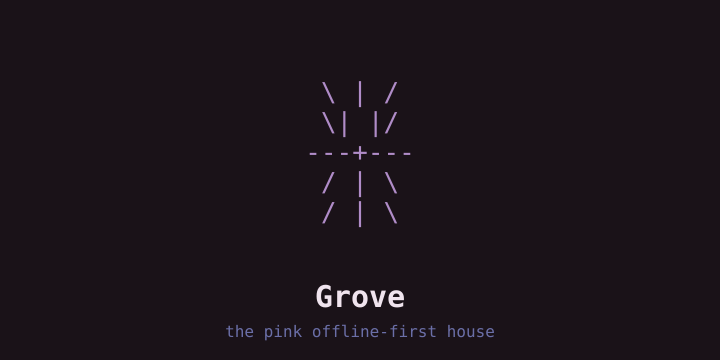

# Grove — the pink offline-first house 🌱

Live: `https://elegantvw.github.io/grove/`. Resume (sendable, all-ages): `https://elegantvw.github.io/grove/resume.html`. The glade (public Worlds shorts): `https://elegantvw.github.io/grove/glade.html` — vertical snap carousel, same catalog as Instagram `@elegantvideoworlds`. For: hiring + worlds + shelf. Magpie `nest-egg`, Siren `sea-glass`, and Goblin `letter-pouch` on the cards are the download exception. Custom PMV (18+) is a separate hire, off-site.

Static front door for the whole column: fire → glass → house. Resume at `/resume.html`. Glade at `/glade.html`.
Opens at the splash, drops you at the fire, climb by scrolling up.

## Shelf

* 🔥 [Kindling](https://github.com/ElegantVW/fae-kernel) — x86_64 firmware + kernel; house light on
* 🛡️ [Bulwark](https://github.com/ElegantVW/bulwark) — host firewall + glass screen lock
* ✨ [Pixie](https://github.com/ElegantVW/pixie) — offline AI agent on your machine
* 🔎 [Magpie](https://github.com/ElegantVW/magpie) — thorough seeker, crawl to cited PDF
* 🎵 [Siren](https://github.com/ElegantVW/siren) — local music + speaker player
* ✉️ [Goblin](https://github.com/ElegantVW/goblin) — TLS mail in your terminal
* 🏮 [Fairy Lantern](https://github.com/ElegantVW/fairy-lantern) — GBA emulator from scratch
* 🏔️ [Mourama](https://github.com/ElegantVW/mourama) — Iberian hillfort strategy game
* 🐉 [Kur](https://github.com/ElegantVW/kur) — answers only in haiku
* 🐲 [Imp](https://github.com/ElegantVW/imp) — terminal art from a wish
* 📜 [Scroll](https://github.com/ElegantVW/scroll) — living book + PATH leaf
* 🌸 [faeOS](https://github.com/ElegantVW/faeOS) — pink offline-first terminal

## Serve

Live (free, no domain): `https://elegantvw.github.io/grove/` via GitHub Pages (Settings → Pages → Deploy from `main` / `/root`).

Local preview:

```bash
cd ~/grove && python3 -m http.server 8000
```

No build, no JS framework, no telemetry. Palette: `fae-kernel/docs/identity/IDENTITY.md`.
Optional air: EVW-994 on the glade page. Off until you tap **♪ hush**. A reload is hush again.

## License

MIT — see [LICENSE](LICENSE). Screenshots are our own machines.
